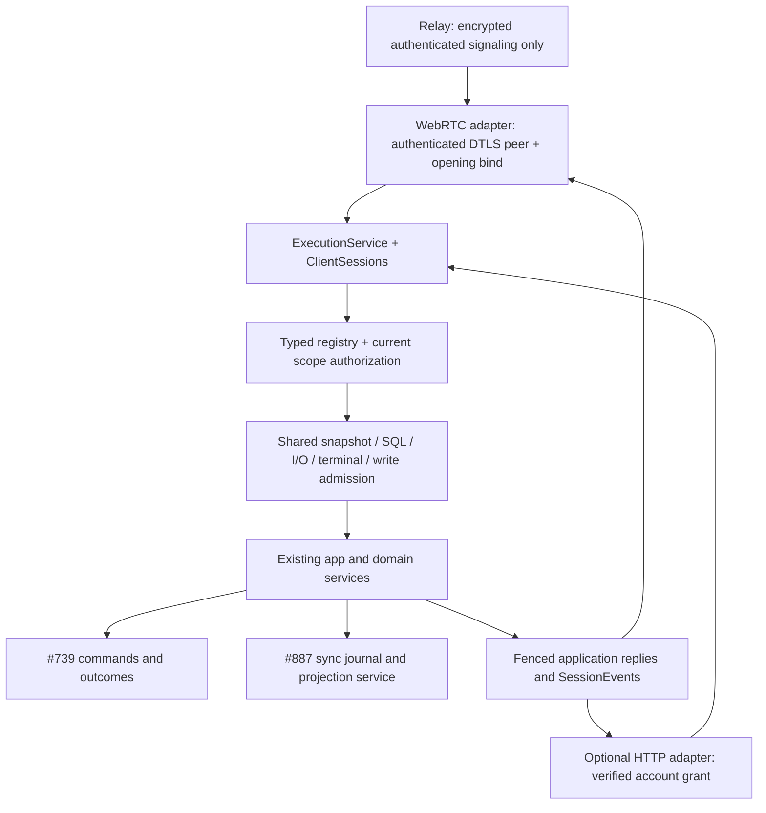
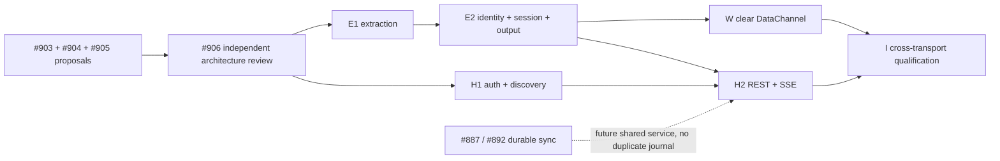

# Shared execution and transport adapter contracts

Proposal for #903 / #902, 2026-10-29. **Design only; pending #906 architecture
review.** Inspected base: `origin/dev` at
`12b8f869bd94e259666df69f1a8c0cde5c695982`. No production implementation or
new durable-write method is authorized by this document.

The bridge will expose one authenticated application execution service to
WebRTC and optional REST/SSE. Adapters authenticate and frame traffic; the
shared service owns authorization, admission, scheduling, execution and output
lifetime. Existing read services and persistence boundaries stay intact.
Removing application encryption from DataChannels does not remove authenticated
signaling or the binding between an authorized caller and the DTLS peer.

## 1. Evidence and decisions

Paths below refer to the inspected base, not the proposed layout.

| Current code | Design consequence |
| --- | --- |
| `carrier.rs::{FrameIntake, SessionSender, Opening}` combines decrypt, opening/carrier fences, receipts, epoch stamping and scheduling | Extract application intake from crypto and retain separate opening and delivery-binding identities. Merely adding `CarrierKind::Http` would preserve the wrong coupling. |
| `carrier/dispatch.rs::{FrameHandler, Dispatcher}` owns worker pools, background limits, terminal order and queued-read folding | Move and adapt this implementation; do not implement another HTTP scheduler. |
| `carrier/sql.rs`, `carrier/sql/observations.rs`, `carrier/io.rs` provide fair per-opening SQL/I/O admission and dedicated workers | Both adapters share the same executor instances, queue limits and cancellation rules. |
| `app/rpc.rs::AppState::handler` captures snapshot, SQL, observation and mutation services | Build the shared execution service at this same daemon bootstrap boundary. Keep those services and their committed publication hooks. |
| `api/v1/mod.rs::{Handler, v1_method!, dispatch}` already names typed parameters/results, with internal JSON adaptation | Extend that registry rather than create a second method table. Remove transport `Frame`/`SessionSender` from the application boundary incrementally. |
| `api/effects.rs` exhaustively classifies methods | Classification, scheduling and durable enablement are separate policies. A method classified `Write` is not necessarily journaled. |
| `api/v1/changes.rs::with_session` passes a thread-local `SessionSender`; uploads also use it | Replace with explicit application call context for subscriptions/uploads; never let asynchronous work inherit ambient caller state. |
| `app/mutations.rs` uses database-local `DEVICE_USER = "device_user"`; `MutationAuthority` checks current original owners | Preserve this principal for both verified owner transports; do not partition command identity by session, credential, protocol or endpoint. |
| `api/writes.rs::ACK_CONFIRM_METHODS` is empty | Today all semantic writes retain their existing final-reply behavior. An HTTP 202 cannot turn one into a durable command. |
| `transport.rs::SessionInit` proves knowledge of a key sealed to the device public key; relay broker checks account ownership | Public-key wrapping and a client hint do not authenticate an account. A clear DataChannel needs verified owner authorization and an authenticated peer binding. |
| `app/runtime/sessions/registry.rs::SessionRegistry` owns agent/PTY registrations | Call the transport-facing registry `ClientSessions`; do not merge these lifetimes or kill processes when an HTTP/SSE stream closes. |

Read for intent: `ARCHITECTURE.md` (topology, RPC, lock/read services, wire
versioning, durable writes, relay), the v2 scope and UI brief, Strict P2P
Transport Spec, Write Acknowledgement Protocol, Native Reads and Durable Write
security checklists. #902 explicitly adds optional HTTP and removes redundant
DataChannel payload encryption; it supersedes the older spec's exclusion of
those features. Relay application-traffic rejection remains required. Existing
sealed web-push notifications are a separate facility and remain unchanged.

## 2. Small module boundary

Start with three cohesive application-facing pieces, not a new framework:

| Proposed location | Owns | Must not own |
| --- | --- | --- |
| `bridge/src/execution.rs` | `ExecutionService`, typed invocation/context/result interfaces, method-policy integration and orchestration | HTTP, SDP/ICE, session keys, envelopes or domain SQL implementations |
| `bridge/src/execution/session.rs` | `ClientSessions`, verified caller/grant handles, opening/binding fences, `SessionEvents`, output admission | Account-token introspection implementation, agent process lifetime, command journal or sync journal |
| `bridge/src/execution/{dispatch,sql,io}.rs` and existing SQL observations submodule | Existing scheduling internals moved from `carrier/`, preserving behavior | Transport parsing and endpoint-specific authorization |

Keep `app/{rpc,mutations,observation_reads,...}`, `api/v1/`, `store/`, and
`changes.rs` in place. `app/rpc.rs` becomes application dispatch glue after
signaling is split out; no broad domain rewrite. `carrier.rs` remains a
WebRTC/legacy encrypted-wire adapter plus rendezvous lifecycle while callers
migrate. `rtc.rs` retains peer identity, signaling and channel ownership.
`http/` is owned by #905 and depends on execution, never on carrier dispatch
internals. Module splitting beyond this requires a real ownership/size need.



## 3. Identity and authorization contract

The following are proposed crate-visible Rust interfaces. They describe the
contract; snippets are not compiled implementation. Identifier newtypes,
errors, method markers and payload structs are abbreviated. Private fields and
sealed traits are intentional.

```rust
pub(crate) struct VerifiedCaller { /* private verified proof, no Deserialize */ }
pub(crate) struct PrincipalId { /* database-local stable actor */ }
pub(crate) struct CredentialId { /* stable revocable HTTP credential family */ }
pub(crate) struct AuthorizationLease { /* proof-specific validity fence */ }

// Internal proof types, not caller-selected modes or alternate security profiles.
enum CallerProof {
    TrustedRelay(VerifiedRelayOwner),
    OnlineAccountGrant(VerifiedAccountGrant),
}

pub(crate) trait CallerVerifier: private::Sealed + Send + Sync {
    type Evidence;
    fn verify(&self, evidence: Self::Evidence)
        -> impl Future<Output = Result<VerifiedCaller, AuthenticationError>> + Send;
}

impl VerifiedCaller {
    pub fn device_id(&self) -> &DeviceId;
}
```

`VerifiedCaller` has exactly two construction paths for the two adapters:

- WebRTC retains the current configured authenticated relay as its account
  authorization source. Mint `VerifiedRelayOwner` only at trusted relay intake
  after the relay's existing user/device ownership validation. Bind it to the
  exact Opening and actual SDP/DTLS peer/channel, with a finite setup/bind
  timeout, before admitting clear application traffic. No new WebRTC account
  introspection, grant refresh, periodic 30-second authorization expiry, or
  availability dependency is introduced. Relay loss after successful channel
  binding retains current session behavior. Additional online WebRTC hardening
  is out of scope, not a second supported profile.
- HTTP bypasses the relay and therefore requires online account/credential
  verification with finite authorization freshness. `VerifiedAccountGrant`
  privately carries account ID, device ID, stable `CredentialId`, canonical
  origin/audience, authorization epoch and expiry. #905 owns hosted
  introspection and this credential policy. Access-token ID is audit-only.

The relay may attest the paired owner implicitly without forwarding a raw
account ID; do not invent one or require HTTP credential fields for WebRTC.
#904 owns authenticated relay intake and the signaling/DTLS evidence. These
trusted integrations alone get a restricted constructor;
there is no public `new(account_id, ...)`, `From<Value>`, or caller-selected
principal. Evidence failures stop before method lookup, snapshot access,
receipts or queue allocation. An endpoint identity proof verifies the server;
it does not replace caller authorization.

For the current single-owner bridge, a shared principal resolver verifies
paired-owner authority from the relevant proof, then maps it to the existing store-local
`device_user` key. Both transports use that exact key for #739 status,
subscriptions, deduplication and dependencies. Credential rotation does not
create a new durable actor. Credential/token IDs remain audit/revocation
metadata. A future ownership transfer must retire grants and explicitly decide
how old journal authority is isolated; this proposal does not expose the old
owner's commands to a new account. MCP agents retain their own authority and
are not mapped to the human principal by this extraction.

Authorization happens before every fast path and again at execution/effect or
output boundaries after waits, according to that proof's validity rules.
A verified caller alone is not a method permission:
the shared method implementation resolves server-owned project/source/owner
IDs and validates current generations, original journal scope, path containment,
reset/deletion/reclaim fences and QA gates. Published authorization/read contexts
serve off-lock reads; no HTTP-only app-lock lookup is added. Per-method guards
remain in their domain service. Recheck authority before delivering replay or
reading an attachment; possession of an operation/entity/session ID grants no
access. An authorization lease is separate from the update-admission lease.

## 4. Sessions, requests and delivery bindings

```rust
pub(crate) struct ClientSessions { /* shared registry */ }
pub(crate) struct SessionLease { /* opening + caller binding */ }
pub(crate) struct ReplyLease { /* one request/binding generation */ }
pub(crate) struct EventBinding { /* one stream generation */ }

impl ClientSessions {
    pub fn open(&self, caller: VerifiedCaller, options: SessionOptions)
        -> Result<SessionLease, AuthenticationError>;
    pub fn resume(&self, caller: VerifiedCaller, id: &SessionId)
        -> Result<SessionLease, AuthenticationError>;
    pub fn bind_events(&self, session: &SessionLease, class: StreamClass,
                       sink: Arc<dyn EventSink>) -> Result<EventBinding, DeliveryError>;
    pub fn bind_peer(&self, session: &SessionLease, proof: VerifiedPeerBinding)
        -> Result<PeerLease, AuthenticationError>;
    pub fn request(&self, session: &SessionLease, reply: ReplyEndpoint,
                   events: Option<&EventBinding>) -> Result<RequestContext, CallError>;
    pub fn close(&self, session: &SessionLease, reason: SessionEnd);
}

pub(crate) enum StreamClass { Application, Terminal }
pub(crate) struct RequestContext { /* private; created by ClientSessions */ }
```

`RequestContext` contains the verified session, exact reply lease, optional
session events handle, request ID, server intake order/time and cancellation
token. `ReplyEndpoint` is a transport response target; it cannot select identity.
`VerifiedPeerBinding` is produced only by #904's peer verification against the
real connection and authenticated transcript. `PeerLease` carries the exact
opening/peer-generation/channel identity and is mandatory at DataChannel intake.
Neither a session ID nor an application frame can fabricate that binding.

`SessionOptions` contains server-approved lifetime/output budgets and diagnostic
labels, not a transport mode flag or user-selected authority. External session
IDs are locators. For HTTP, `resume` requires the same verified account, device,
stable credential family, canonical origin and authorization epoch, with an
unexpired opening. #905 defines `CredentialId` as a revocable device/client
installation or tab family; its 5-minute access tokens rotate independently.
Hosted authenticated refresh rechecks ownership, epoch and family. There is no
bridge-held direct refresh token. A new family/epoch/account/device/origin
requires reopen. Grants cannot extend an opening beyond their verified
validity without explicit renewal verification. WebRTC reattachment instead
retains the current same-session/key trusted-relay proof and exact opening/peer
fences; HTTP renewal rules do not apply to it.

Each opening has a fresh process-local unforgeable generation, equivalent to
the existing allocation identity in `Opening`. Each reply or stream has its
own binding generation. Reusing a textual session or subscription ID cannot
revive an old sender. The registry creates `ReplyLease` and request-order values
at authenticated intake; JSON cannot construct them. Event capability handles
are bound to the same opening; cross-session targets are rejected.

HTTP requests in one live session share that opening's admission accounting,
but have separate response targets. A fresh request does not close the previous
one. SSE replacement retires the old event binding and its subscriptions,
without canceling an independent REST response or closing the opening. A lost
SSE response does not imply a lost command. Reconnection registers its desired
subscriptions against a fresh binding and recovers from the relevant durable
service. Socket requests in a WebRTC opening retain their exact carrier-bound
reply fences; closing the signaling relay under live DataChannels is benign.

No generic "last socket closes" policy is applied to HTTP. It has explicit
close plus verified expiry/idle expiration; #905 defines those finite times.
WebRTC retains last-active-carrier/explicit-close semantics with authenticated
reattachment. Opening close, or HTTP grant expiry/revocation, invalidates all bindings,
prunes queued callers, interrupts permit waits and releases subscriptions,
uploads and terminal **attachments** exactly once. Cleanup carries the opening
token, so delayed cleanup cannot drop replacement subscriptions/uploads. It
does not destroy an agent/PTY or undo accepted application work.

Cancellation has three separate meanings:

| Boundary | Result |
| --- | --- |
| A request/stream closes before work starts | Remove that caller from queued/folded work and cancel waits. Other folded callers remain. No side effect starts for a dead caller. |
| A read or observation is already running | Suppress output to the retired binding; interrupt work when supported. Retain executor/connection capacity until actual completion. Revalidate scope before producing a usable result. |
| A legacy immediate mutation has crossed its effect boundary | It may complete. A disconnected response is ambiguous; never claim rollback or automatically retry with a fresh operation identity. |
| A durable command was committed to #739 admission | Opening/request loss does not cancel it. Domain service settles it without a client; reconnect reads its saved outcome. Session-scoped durable effects retain the protocol's `scope_ended` rule before effect. |

There is no new generic command-cancel verb. Existing `agent.interrupt`,
`term.close`, upload abort and domain cancellation remain explicit commands
with their current authorization and instance fences.

Cancellation racing durable admission needs one explicit linearization point:
if cancellation wins before admission commits, no new command is admitted;
if the admission transaction commits first, the command remains accepted even
if its ack cannot be delivered. Reconcile using the same operation ID. Never
discard a committed record because the response target disappeared.

## 5. Typed invocation and scheduling

```rust
pub(crate) trait Method: private::Sealed + Send + 'static {
    type Params: DeserializeOwned + Send;
    type Metadata: Send;
    type Reply: Serialize + Send;
    const NAME: &'static str;
}

pub(crate) struct Invocation<M: Method> {
    pub params: M::Params,
    pub metadata: M::Metadata,
}

impl ExecutionService {
    pub async fn submit<M: Method>(&self, context: RequestContext,
                                  request: Invocation<M>)
        -> Result<Call<M::Reply>, CallError>;
}

impl<T> Call<T> {
    pub async fn reply(self) -> Result<T, CallError>;
}
```

The sealed registry assigns `Metadata = NoWrite` and `Reply = Final<R>` to
reads/immediate commands. Only individually enabled durable method markers use
`Metadata = WriteMetadata` and `Reply = Accepted<A>` (typed acceptance data).
Their terminal `R` is carried by typed #739 confirmation/status envelopes.
There is no `mode`, `durable: bool`, arbitrary execute callback, or public
`Command { method: String, params: Value }` API. Registry-generated wire decode
erases heterogeneous method types internally after strict parsing; the checked
result is serialized once at the shared wire boundary. `api/v1` remains the
source of parameter and result types. Legacy JSON implementation shims stay
private and retain deferred-result validation until individually migrated.
Avoid a second exhaustive giant enum/table beside `v1_method!`.

`submit` may wait for bounded admission and returns the live call handle; it
does not signify durable acceptance. `Call::reply` yields a final reply or
durable ack according to the sealed method policy. Dropping it cancels that
caller's interest using the rules above. The existing optional transport
receipt (`accepted:true`) is a separate intake notification delivered to the
reply binding before scheduling; it does not inhabit `M::Reply`. HTTP can omit
that progress notification. HTTP returns 202 only with an actual #739 saved
ack, not a queue receipt. Only the execution registry chooses a lane; adapters
cannot choose SQL connections, app guards or recovery policy.

Request ordering is stamped by shared intake. One WebRTC wire retains ordered
admission; separate HTTP requests have no inferred browser send order beyond
server intake. Clients serialize terminal commands and await their replies,
or use a separately specified sequenced terminal stream; this slice does not
invent reliable PTY retry semantics. Conflicting durable commands use saved
owner order/dependencies, not HTTP arrival assumptions. Explicit `after` keeps
its absent versus empty meaning.

| Lane | Preserved implementation and behavior |
| --- | --- |
| Control | Ping/stats and signaling do not wait behind disk/write queues. Signaling belongs to WebRTC, outside application method dispatch; HTTP cannot call `rtc.*` via a generic method endpoint. |
| Published snapshots | Current 15 intake methods use immutable views without a SQL permit, dispatch slot or app guard. Authentication and typing still apply. |
| SQL | Current 10 methods, including writes status/subscribe; 8 shared dedicated SQL threads and 8 read-only WAL connections, warmed before reachability. Fair per-opening queue with at most 16 waiting callers including checkout waits. Capacity parks intake; no new SQL capacity `busy`. |
| Observation | Independent 16-caller per-opening backlog, up to 8 reused dedicated I/O threads. Mixed metadata preparation shares SQL workers, then releases transaction/connection before physical I/O. Pure I/O continues while mixed jobs await SQL. |
| Immediate/legacy mutation | Current 8 dispatch workers, foreground/background queues, at most 2 background workers, 256 queue depth and 1024 per-wire intake depth. Preserve current fast attachment behavior during extraction; any new bounding is separately reviewed. |
| Terminal | Current per-terminal ordered lanes (64 queue depth), close/cleanup semantics and byte/ack flow control. Terminal traffic does not consume the general write worker limit. |
| Durable | #739 performs short SQL-only admission outside app/domain guards, then domain execution/recovery. Do not occupy an HTTP request worker for the lifetime of an accepted command. |

Queued read folding retains method, normalized params, principal/authorization,
opening and relevant source/generation compatibility; subscriptions never fold.
Nothing joins a running query. Every caller retains its own reply ID, intake
time and binding; canceling one does not cancel the other callers. Preserve
existing FrameClock queue/SQL/I/O/app-lock measurements across adapters.

Share the existing update-admission service: reads can take counted leases
during a pending handoff, writes respect exclusion, and routed work retains
its lease through off-lock work/drain. No per-adapter duplicate lease or queue.
Read service work remains off the app/writer guards; the extraction does not
claim to remove existing legacy lock-held Store calls.

HTTP also needs finite account/credential connection and in-flight admission
limits *before* opening or spawning request tasks; a fresh session per request
must not bypass the 16-caller lanes. #905 owns outer request/connection limits,
while shared execution counts authorized openings/in-flight work across
adapters. Set and test budgets with integration evidence, without changing the
SQL lane into retryable capacity refusals. Preserve <=100 ms service/read gates
and measure queue wait separately; do not hide waiting as execution time.

## 6. Output contract and backpressure

```rust
pub(crate) trait EventSink: Send + Sync {
    fn try_send(&self, event: EncodedEvent) -> Result<(), DeliveryError>;
}

impl SessionEvents {
    pub fn publish<E: ApplicationEvent>(&self, event: &E)
        -> Result<(), DeliveryError>;
}

pub(crate) enum DeliveryError { Closed, Full, Unauthorized, TooLarge }
```

`SessionEvents` is the application replacement for `SessionSender` in producers.
It knows the opening, binding, authorization lease, byte budget and server
epoch. `ApplicationEvent` is sealed and backed by the existing push families;
`EncodedEvent` is a privately constructed validated payload, not a crypto
envelope or arbitrary client JSON. There is no codec/key inside application
producers. Transport adapters receive already stamped application output,
then perform only their wire framing/legacy encryption as negotiated.

Every successful application reply, receipt and event carries the server's
`bridge_epoch`; overwrite producer-supplied epoch before emission. The epoch
fences a process, not authority or journal continuity. Emission checks both
opening and binding atomically with replacement/close, preserving
`push_scoped`'s race guarantee. Bound queued encoded bytes as well as item
counts. Successful enqueue means handed to the adapter, not browser receipt
or durable-cache commit. The initial extraction preserves output behavior;
finite HTTP output and unified byte accounting must land before HTTP enables.

Domain producers must never wait on sockets while holding app/domain locks.
Terminal streams retain their existing acknowledged window/offset and pause
rules. Ordinary ChangeBus pushes retain existing coalescing/invalidation
semantics. On a full SSE queue, retire that event binding and require its
documented recovery path; never silently discard an outcome and advance a
cursor. A large final HTTP response is written asynchronously outside the
execution workers, with a finite response budget. Stream failure cannot
change a committed command outcome.

Keep output categories explicit:

| Output | Recovery owner |
| --- | --- |
| Final reply to read/legacy immediate write | Request binding; a lost legacy write reply can be ambiguous |
| Durable ack / `writes.confirmed` | #739 saved state and terminal outbox; authenticated bounded status/subscribe closes races and rechecks original scope |
| Ordinary `changes.*` wake/invalidation | Existing ChangeBus; it has no durable cursor/no-gap guarantee |
| Scoped durable cache synchronization | #887 / #892 service, including consistent snapshot watermark, finite catch-up, retention floor and explicit resnapshot |
| PTY bytes, diagnostic streams | Existing stream-specific sequence/ack/reattach mechanisms; not the command or sync journal |

SSE is a framing of these categories. For this delivery it carries honest
transient hints with existing reconnect/current-state refresh, plus existing
#739 confirmations; recover confirmations via
the service's snapshot-and-subscribe protocol. #887 wakeups can later trigger
the same bounded scoped reads over either transport. Only #887 owns the sync
cursor format, snapshot consistency, tombstones and compaction. Ordinary
bridge restart preserves journal identities while changing the process epoch;
the future #893 client commits cache changes plus the applied #887 cursor
atomically. Lost wakeups in that future durable sync use #887's periodic head
check, not a second HTTP event log. #892 is not dispatched and has no frozen
API/trait/capability names or ETA; #893 owns cache catch-up. This proposal
freezes none of those names. Never expose ChangeBus IDs or SSE local counters
as resume cursors, and do not accept `Last-Event-ID` as an unimplemented replay
promise. Durable SSE replay remains separately capability-gated future work.

## 7. Durable operations and error mapping

Reusing #739 means keeping `(PrincipalId, canonical operation UUID)` as the
command key, normalized semantic intent/original targets and explicit
dependencies as the conflict fence. Transport metadata, request ID, token,
endpoint and process epoch are excluded from semantic identity. A retry on
REST after a WebRTC disconnect returns the saved ack/result for enabled
methods; a different intent conflicts without effects. Resolve an existing
command before mutable aliases or fresh child IDs. Expired result tombstones
prevent reuse. Accepted-but-missing or different-incarnation commands require
reconciliation, never automatic re-execution. External effects use existing
operation/delivery/review recovery, including unknown/partial outcomes.

Do not enable generic journaling in the transport extraction. Semantic method
enablement is a separate task under the Write Acknowledgement Protocol, with
retention/compaction, permitted stored fields, tombstone redaction, recovery
before readiness, crash tests and per-method advertised allowlist. No #739
journal schema changes are needed for this design. #887's state-change journal
is separate even when one SQL mutation must eventually update both atomically;
its owner supplies the transaction/publication integration.

Application failures retain `ApiError` and existing `error_code`, `retryable`,
`details` and message shapes. At this base the 12-code set is closed; new
top-level codes require the documented wire compatibility decision. Keep
authentication/protocol/HTTP-envelope errors in adapter error types, never
extend `ApiError` incidentally or classify new errors by matching strings.

| Failure | HTTP mapping | WebRTC/shared semantic mapping |
| --- | --- | --- |
| Missing/expired/invalid credential | 401 before execution | Refuse grant/binding before application traffic |
| Authenticated but wrong device/owner/origin permission | 403 before execution, no object details | Refuse grant/binding; no application response leak |
| Bad HTTP body/media/size | 400 / 415 / 413 before execution | Adapter's frame/chunk limits; no handler effect |
| `invalid_params`, `unknown_method` | 400, existing JSON error body | Existing ApiError body; preserve named unsupported method |
| `not_found` after authorized resolution | 404 | Same ApiError body |
| `already_exists`, `locked`, `conflict`, `stale_version`, `stale_body` | 409 | Same code/details; no automatic mutation retry |
| `busy` from an existing eligible gate | 503, optional Retry-After | Existing `retryable:true`; SQL/I/O queue capacity still parks |
| `unavailable`, `unsupported_version` | 503 / 426 | Existing nonretryable code with structured reason |
| `internal` | 500, redacted message | Same typed error; retain diagnostic correlation internally |
| Final result / saved durable ack | 200 / 202 respectively | Final reply / existing typed ack respectively |

Outer HTTP rate limits may use 429 without inventing a domain ApiError. Response
disconnect or timeout is delivery failure, not evidence of `unapplied` effects.
Only a saved #739 failure can claim its `unapplied | partial | unknown` outcome.
No automatic REST failover/retry of a legacy write after ambiguous WebRTC send.
An HTTP status does not replace parsing the shared error body. #905 owns exact
REST routes, discovery/JWS encoding, TLS/origin/CORS/CSRF policy and client UX;
these must agree with this classification before implementation.

## 8. Compatibility and implementation slices

The extraction alone changes no wire version, capability, fixture, schema,
crypto selection or UI. Existing encrypted client/bridge combinations must
continue to work. A later clear DataChannel codec is selected only inside
authenticated signaling, pinned to the opening and exact peer/channel;
no trial parsing, plaintext sniffing, unauthenticated fallback or mid-opening
format change. #904/#906 decide the advertised codec/version and downgrade
policy. Mixed-version encrypted support may be kept during migration; if
removed, it requires an explicit supported-floor decision and clear failure.

HTTP is optional, disabled unless explicitly configured, and advertises its
own endpoint capability. It must not change WebRTC presence/reachability or
make the signaling relay an application proxy. Supported method sets can
exclude WebRTC-only controls, but shared domain methods retain exactly the
same types, constraints and semantics. Legacy hello capabilities, task summary
selection, paged body limits, QA restrictions and `ack_confirm_methods` remain
authoritative. A newer HTTP adapter must not advertise pending #887 semantics.
SPA adapter changes must feed the existing cache/RPC machinery; views still
render from cache with no transport-aware product logic.

#905's Add by URL client release requires full nonterminal resource coverage
for the advertised client capabilities. An automation-only method subset does
not authorize enabling that connection UI. A terminal HTTP stream needs its
own implemented flow-control/ordering coverage before advertisement; the
shared boundary preserves the existing WebRTC terminal regardless. Desktop
uses its native main-process adapter for scoped device tokens while retaining
the existing restricted renderer OAuth interception. #905 owns that client
integration and coverage matrix; E1/E2 do not broaden desktop credential access.

Coordinator creates implementation/review assignments; the names below are
slice ownership, not new dispatches from #903.

| Slice | Owner and change boundary | Prerequisite / evidence |
| --- | --- | --- |
| E1: application entry extraction | Shared-execution implementer: `execution.rs`, move existing scheduler internals, minimal `app/rpc.rs` glue. Carrier delegates with legacy session/output shim. Keep read services unchanged. | #906 contract approval; same inputs/outputs and lane/cancellation tests before behavior changes |
| E2: identity/session/output seam | Shared-execution implementer with #905/#904 verifier integration: `execution/session.rs`, explicit context in mutation subscriptions/changes/uploads, generation-fenced targets, bounded output accounting. | E1; legacy adapter parity, revocation races, stable principal tests, output pressure tests |
| W: clear DataChannel payload | #904 track: authenticated signaling/transcript + DTLS/opening/channel binding, adapter codec and SPA peer/session codec | E2 plus independent security review; legacy/version matrix, tamper/replay/wrong-channel tests |
| H1: HTTP authority/discovery | #905 track: hosted credential/introspection/discovery, endpoint identity, optional listener configuration | Contract approval; can develop in parallel with E1, cannot enter execution without E2 |
| H2: REST/SSE + client adapter | #905 track: HTTP framing/routes/limits, typed invocation decoding, response/SSE bindings, URL flow | E2 + H1; cross-adapter typed/error/lifetime tests. W is not a dependency. |
| I: qualification | Coordinator assigns Terra implementation reviews and independent Astra integration review | W + H2; compatibility/security matrix, measured small/large workloads, all final gates |



No blocking dependency on #887 is required to expose honest transient SSE and
existing #739 outcomes. Advertising no-gap scoped synchronization does require
the approved #887 service and its producer/cursor coverage. Rebase each slice
from freshly fetched dev before implementation: #900/#901/#891 may alter task
types and consumers meanwhile. Coordinate overlapping shared dispatch and API
version edits with sync owner `agent-01M5WBZBZA98NA88WRZKHNW61K` before changing
them; do not import unreviewed work or duplicate migrations. Source decisions:
#887/c/tc-01M5WC725H9WG86KQNDZH008JX and
#887/c/tc-01M5WDTY9K8288DND6RQX08DTN (read in the #887 task timeline).

## 9. TDD acceptance matrix and review evidence

Implementation tests are written red first; each slice records failing and
passing commands/exit codes at exact base/head. This documentation-only task
does not fabricate executable tests for unimplemented interfaces.

| Acceptance | Test seam / meaningful failure to establish before implementation |
| --- | --- |
| Extraction has byte/semantic parity | Run the same `api_contract`, `write_wire_contract`, epoch and legacy carrier fixtures through delegation; all registered methods have one policy and typed result validator, including deferred replies. |
| Unauthorized fast paths disclose nothing | Invalid/wrong-device grant against snapshot, SQL, attachment, stats, subscription and mutation paths produces no handler, receipt or unauthorized payload; malformed request cannot construct a grant. |
| Stable cross-transport principal | Admit an enabled test command on one adapter, retry/status/subscribe on the other and after credential refresh; one saved command/outcome, no second domain effect. Foreign owner and reused UUID with different intent fail. |
| Credential revocation is distinct from command identity | Rotate HTTP access-token ID in one CredentialId family: opening renews only after verified refresh. Revoke/change family or origin/epoch: opening dies/reopens, old output is fenced, while same verified owner's saved command stays accessible through another valid transport. |
| WebRTC availability is preserved | Configured relay intake mints owner proof only after existing ownership checks. Untrusted/direct SessionInit fails to mint it. Bind timeout or wrong actual peer/channel fails closed; later relay loss does not expire an established channel or introduce periodic introspection. |
| SQL isolation and fair bounded admission | Hold app and writer guards while reads succeed within 100 ms; saturate all SQL permits and 16-caller opening backlog, verify ordered parking, competing-opening progress, no capacity `busy`, no extra executor threads. |
| Observation independence | Hold mixed-job SQL preparation while pure I/O progresses; connection released before I/O; count actual physical work <=8; closing one folded carrier does not suppress survivors. |
| Immutable reads and update handoff | Snapshot reads proceed with all other lanes held; counted read lease prevents handoff completion; write exclusion and off-lock drains preserve existing behavior. |
| Opening/binding replacement is safe | Close/reopen same textual session, replace SSE/subscription, race completion/revocation/expiry/cleanup. Old replies, uploads and cleanup never reach or delete replacements; an independent HTTP response survives SSE close. |
| Cancellation preserves capacity | Cancel permit waits and queued callers, then a running job. No execution after dead queued caller; running canceled work retains resources until real finish; no leaked folds/worker permits. |
| Terminal semantics stay exact | Input/ack/resize/close retain per-terminal intake order and byte windows. HTTP caller serialization and reattach tested with actual output; disconnect releases attachment, not PTY. |
| Output cannot grow without bound | Slow/drop SSE reader under publication and terminal load; byte/item caps enforced, producer never waits under app lock, stream retires explicitly, confirmation remains recoverable. |
| Durable and legacy writes are distinguished | Empty allowlist still rejects write metadata everywhere. Disposable #739 enabled-method fixture proves ack only after SQL commit, crash recovery without duplicate effect, original-scope checks and expired tombstones. Legacy timeout never synthesizes rollback/ack or automatic retry. |
| Crypto removal retains identity | #904 tests tampered SDP/fingerprint/codec, unbound peer/opening/channel, replayed bind, same-account different session, downgrade and encrypted/clear mismatch. Relay still refuses application traffic. |
| Sync ownership is preserved | Dropped SSE wakeup recovers by authoritative service read; no SSE counter accepted as #887 cursor. Later #892 tests snapshot/replay gap, deletion/filter exit, retained-floor reset and periodic head check on both adapters. |
| Error/compatibility parity | Parameterized WebRTC/HTTP test compares same authorized domain call/result/error code/details and epoch; old/new codec and optional-HTTP matrices include failed negotiation and unsupported floor. |
| Product behavior/performance | SPA adapter tests preserve cache-only painting, immediate user writes, no whole-list fallback on partial pages. Capture small/single-project/large latency, queue time, bytes and memory before/after with #869 harness where relevant. |

Use existing `carrier::{sql_tests,observation_tests,snapshot_tests,epoch_tests}`,
runtime native-read/update/terminal tests and mutation-journal tests as
regression anchors; relocate tests only with their ownership. Gates run under
`nice -n 10` and are judged by exit code: focused Cargo tests, Clippy all targets
with warnings denied, format and complexity ratchet; targeted SPA tests/lint/
build for client slices; explicit-path Semgrep before ready and Gitleaks before
pushes. Security checklists for implemented controls need actual evidence, not
an inherited 100/100 label. Terra reviews each implementation for scope and
correctness; Astra reviews architecture/integration and after more than two
failed Terra rounds, as #902 requires. No live bridge, production deploy,
shared-source merge, or dev/main push is part of these slices.

Architecture review must freeze the verifier construction boundary, HTTP credential
refresh binding, codec/downgrade policy and HTTP budgets/times with #904/#905.
This proposal chooses the shared service ownership and stable principal; it
does not claim those security or performance gates have already passed.
